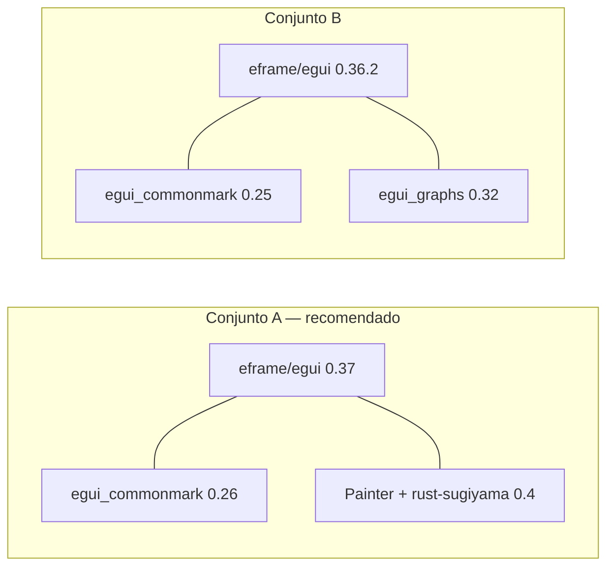

# Viabilidade do ecossistema egui para a v2

> Pesquisa do ticket [#25](https://github.com/edalcin/MyProvenance/issues/25) (mapa [#20](https://github.com/edalcin/MyProvenance/issues/20)). Plano base: [`docs/versao2.md`](../versao2.md). Data: 2026-11-04. Alvo: **só Windows x64**.
> Método: fontes primárias (crates.io API, repos/changelogs/issues no GitHub, docs oficiais). **Nada foi compilado ou executado** — onde falta evidência primária está marcado `[INFERÊNCIA]`.

## Veredito

| # | Ponto | Veredito |
|---|---|---|
| 1 | Editor Markdown + preview | **Viável com ressalva** |
| 2 | Grafo DAG com layout hierárquico | **Viável com ressalva** |
| 3 | `.msi` no `windows-latest`, sem WebView | **Viável** |
| 4 | Tamanho de binário | **Viável** (com `glow` + LTO) |
| 5 | AccessKit + tema claro/escuro | **Viável com ressalva** (tema ok; a11y parcial) |

Conclusão: egui serve para a v2. Três decisões que mudam o `docs/versao2.md`:

1. **Pinar `eframe`/`egui` na mesma minor** que os crates de terceiros (hoje: 0.36 ou 0.37, ver [Matriz de versões](#matriz-de-versões)).
2. **Backend `glow`, não o `wgpu` default** — metade do binário e ~3× menos RAM.
3. **Grafo: `egui::Painter` + `rust-sugiyama`**, não `egui_graphs` (layout hierárquico dele é árvore, não DAG em camadas; sem release para egui 0.37).

## Matriz de versões

Versões estáveis em 2026-11-04 ([crates.io API](https://crates.io/api/v1/crates/egui)):

| Crate | Versão | Publicada | Depende de |
|---|---|---|---|
| `egui` / `eframe` / `egui_extras` | **0.37.0** | 2026-10-15 | — |
| `egui` | 0.36.2 | 2026-09-08 | — |
| `egui_commonmark` | **0.26.0** | 2026-10-15 | `egui ^0.37`, `pulldown-cmark ^0.13` ([deps](https://crates.io/api/v1/crates/egui_commonmark/0.26.0/dependencies)) |
| `egui_commonmark` | 0.25.0 | 2026-08-05 | `egui ^0.36` |
| `egui_graphs` | **0.32.0** | 2026-08-31 | `egui ^0.36`, `petgraph ^0.8` ([deps](https://crates.io/api/v1/crates/egui_graphs/0.32.0/dependencies)) |
| `rust-sugiyama` | 0.4.0 | 2025-09-21 | `petgraph ^0.8.1`, `log` ([deps](https://crates.io/api/v1/crates/rust-sugiyama/0.4.0/dependencies)) |
| `petgraph` | 0.8.3 | 2025-09-30 | — |
| `accesskit` | 0.25.2 | 2026-10-25 | — |
| `cargo-packager` | 0.11.8 | 2025-11-27 | — |
| `cargo-wix` | 0.3.9 | 2025-03-13 | — |

Pontos:

- `egui_commonmark` acompanha o egui no mesmo dia (0.26.0 = 2026-10-15).
- `egui_graphs` atrasa: 0.32.0 saiu 26 dias depois do egui 0.36.0 (2026-08-05); **até hoje não há release para 0.37**. Mismatch de minor do `egui` = dois crates `egui` no grafo de dependências → tipos incompatíveis (erro de compilação).
- Conjuntos que compilam **hoje**:
  - A: `eframe/egui 0.37` + `egui_commonmark 0.26` + Painter próprio (**recomendado**).
  - B: `eframe/egui 0.36.2` + `egui_commonmark 0.25` + `egui_graphs 0.32`.



## 1. Editor Markdown + preview — viável com ressalva

**Preview**: `egui_commonmark` 0.26 ([README](https://github.com/lampsitter/egui_commonmark/blob/master/README.md)).

- Viewer sobre `pulldown-cmark`; CommonMark + tabelas, strikethrough, tasklists, footnotes.
- `CommonMarkViewer::new().show(ui, &mut cache, markdown)`.
- Features opcionais: `better_syntax_highlighting` (syntect), `svg`, `fetch`, `embedded_image`, `macros`.
- 0.26.0 trouxe busca de texto com highlight (`update_search_matches`, `go_to_match`) — [CHANGELOG](https://github.com/lampsitter/egui_commonmark/blob/master/CHANGELOG.md).
- Manutenção: ~2,2 M downloads; release em 2026-10-15; 7 issues abertas ([repo](https://github.com/lampsitter/egui_commonmark)).

**Editor**: **não existe** crate de editor Markdown WYSIWYG. `egui_commonmark` é só viewer. Editor = `egui::TextEdit::multiline` (core do egui) + preview ao lado, como previsto no plano. Busca em crates.io por "egui markdown" só devolve o viewer ([search](https://crates.io/api/v1/crates?q=egui%20markdown&sort=downloads)).

Ressalvas:

| Ressalva | Fonte | Impacto |
|---|---|---|
| Regressão 0.37: clicar num botão fora do `TextEdit` colapsa a seleção **antes** do código do botão rodar → toolbar "Negrito/Itálico" lê seleção vazia. Aberta. | [egui#8763](https://github.com/emilk/egui/issues/8763) | Só afeta toolbar de formatação. Contorno: guardar o `CCursorRange` do frame anterior; ou omitir toolbar (plano já aceita "textarea + preview"). Em 0.36.2 funciona. |
| Issue aberta: "Doesn't work when selecting multi-line text" (título; detalhes não lidos) | [commonmark#80](https://github.com/lampsitter/egui_commonmark/issues/80) | `[INFERÊNCIA]` seleção/cópia de trechos longos do preview pode falhar; testar. |
| Tooltip de URL ao passar o mouse não aparece por default | [commonmark#111](https://github.com/lampsitter/egui_commonmark/issues/111), README FAQ | Cosmético; README dá o ajuste. |
| Highlight de sintaxe Markdown no editor: `egui_extras::syntax_highlighting` lista só C/C++/JS/TS/JSON/Python/Rust/shell/SQL/TOML/YAML no fallback; Markdown exige feature `syntect` | [syntax_highlighting.rs](https://github.com/emilk/egui/blob/main/crates/egui_extras/src/syntax_highlighting.rs) | Editor sem cor, ou `syntect` (+ tamanho de binário `[INFERÊNCIA]`). Não é requisito do plano. |
| Acentuação pt-BR (dead keys: `´ ~ ^ \``) no `TextEdit` em Windows | Busca em issues do egui e do winit não achou bug aberto de dead keys; há IME aberto ([egui#2317](https://github.com/emilk/egui/issues/2317), 2022) | `[INFERÊNCIA]` provavelmente ok; **testar no protótipo** com layout ABNT2. |

Imagens no Markdown: precisam de `image = { version = "0.25", default-features = false, features = ["png"] }` (README do commonmark). v1 não embute imagens `[INFERÊNCIA — confirmar no protótipo]`.

## 2. Grafo de proveniência (DAG) — viável com ressalva

### `egui_graphs` 0.32 ([README](https://github.com/blitzarx1/egui_graphs/blob/master/README.md))

Bom: zoom/pan, clique/seleção/hover/arrastar, labels, tema claro/escuro via estilo do egui, `DisplayNode`/`DisplayEdge` customizáveis, `petgraph`.

Problemas:

1. **Sem release para egui 0.37** (ver matriz). `[workspace.dependencies]` do master ainda é `egui = "0.36"` ([Cargo.toml](https://github.com/blitzarx1/egui_graphs/blob/master/Cargo.toml)).
2. **README: "The project is not in active development."** Último commit 2026-08-31 (bump de egui); 9 issues abertas; 708 estrelas ([repo](https://github.com/blitzarx1/egui_graphs)).
3. **`LayoutHierarchical` é layout de árvore, não de DAG em camadas.** Pelo [código](https://github.com/blitzarx1/egui_graphs/blob/master/crates/egui_graphs/src/layouts/hierarchical/layout.rs):
   - DFS a partir das raízes (nós sem arestas de entrada); cada nó é posicionado **uma vez**, sob o **primeiro** pai visitado;
   - linha = profundidade na DFS (não rank por caminho mais longo); coluna = contador incremental;
   - sem redução de cruzamentos, sem nós dummy para arestas longas.
   - Issue aberta de resultado ruim: [egui_graphs#290](https://github.com/blitzarx1/egui_graphs/issues/290).
   - Proveniência é DAG com múltiplos pais (uma Entidade usada por várias Atividades; uma Atividade gera várias Entidades — ADR-0008). Layout legível **não** sai do built-in.
4. Aresta é reta/curva entre nós; **não há roteamento** em torno de nós intermediários `[INFERÊNCIA]`.

### `rust-sugiyama` 0.4 ([README](https://github.com/paddison/rust-sugiyama))

- Sugiyama completo: remoção de ciclos (`greedy_feedback_arc_set` do petgraph), rank (Gansner et al.), redução de cruzamentos (barycenter/median), coordenadas (Brandes–Köpf), nós dummy (`dummy_vertices`, default `true`) — [configure.rs](https://github.com/paddison/rust-sugiyama/blob/main/src/configure.rs).
- API: `from_graph(&StableDiGraph)` → `(Vec<(NodeIndex, (x, y))>, width, height)` por componente conexo.
- Ressalvas: último commit 2025-09-21 (estável, pouco movimento); ~61 mil downloads; só posições — desenho (retângulos, setas, curvas) é por conta do app.

### Recomendação

Painter próprio:

- Layout: `rust-sugiyama` (camadas, esquerda→direita) uma vez por mudança no registro.
- Pan/zoom: `egui::Scene` (core, `TSTransform`) — [scene.rs](https://github.com/emilk/egui/blob/main/crates/egui/src/containers/scene.rs).
- Desenho: `ui.painter()` — retângulos arredondados (cor/forma por tipo: Agente/Entidade/Atividade), setas, label; hit-test com `ui.interact(rect, id, Sense::click())`.
- Tema: usar `ui.visuals()` → claro/escuro grátis.
- Tamanho: DAG de um registro = dezenas de nós `[INFERÊNCIA]` → sem problema de performance.
- Fallback se o Painter virar custo: `egui_graphs` (conjunto B) com `set_location` aplicando as posições do sugiyama. Mesmo assim, fica pinado em 0.36.

Descartados: `egui_node_graph` (sem release estável, última atualização 2022-12-10 — [crates.io](https://crates.io/crates/egui_node_graph)); `egui-snarl` 0.12 (editor de nós para edição visual, modelo mental diferente — não é visualizador de DAG).

## 3. `.msi` no GitHub Actions — viável

- **`cargo-packager` 0.11.8** gera `.msi` via WiX Toolset e também NSIS `.exe` ([README](https://github.com/crabnebula-dev/cargo-packager/blob/main/README.md)).
  - Tem exemplo oficial com **egui**: [`examples/egui`](https://github.com/crabnebula-dev/cargo-packager/tree/main/examples/egui) (`before-packaging-command = "cargo build --release"`, `product-name`, `identifier`, `icons`).
  - Config: `[package.metadata.packager]` no `Cargo.toml`; comando `cargo packager --release`.
  - Baixa sozinho `wix311-binaries.zip` (WiX 3.11, com checagem SHA-256) e roda `candle.exe` + `light.exe` ([wix/mod.rs](https://github.com/crabnebula-dev/cargo-packager/blob/main/crates/packager/src/package/wix/mod.rs)). Não exige instalar WiX no runner (precisa de acesso a github.com).
  - Repo ativo: último commit 2026-11-03; 501 estrelas; 42 issues abertas. **Release publicada** mais recente: 0.11.8 (2025-11-27).
- **WebView2 não é exigido**: o template WiX só emite bootstrapper do WebView2 sob `{{#if install_webview}}` (opt-in, config de apps Tauri/wry) — [main.wxs](https://github.com/crabnebula-dev/cargo-packager/blob/main/crates/packager/src/package/wix/main.wxs). App egui não o liga.
- **Alternativa `cargo-wix` 0.3.9**: usa WiX instalado no sistema. A imagem `windows-latest` (hoje `windows-2025-vs2026`) traz **WiX Toolset 3.14.1.8722** e Rust 1.99.1 ([image readme](https://github.com/actions/runner-images/blob/main/images/windows/Windows2025-VS2026-Readme.md)). Última release 2025-03-13; último commit 2026-07-17 (deps). O próprio README alerta: WiX 3 (legacy) sem suporte dos desenvolvedores; WiX 4+ precisa ser instalado explicitamente ([cargo-wix README](https://github.com/volks73/cargo-wix/blob/main/README.md)).
- Ambos dependem de WiX 3 (legacy). Aceitável para v2; risco de longo prazo `[INFERÊNCIA]`: se o WiX 3 sair da imagem, trocar para WiX 4+ (`cargo-wix`) ou NSIS (`cargo-packager`).
- VC++ Redistributable: Rust MSVC liga o CRT dinamicamente por padrão `[INFERÊNCIA]`; o [Rust Reference](https://github.com/rust-lang/reference/blob/master/src/linkage.md) documenta `-C target-feature=+crt-static` para linkar estaticamente. Recomendado para o instalador não exigir redist; validar no CI.
- Fora de escopo (já no plano): assinatura/SmartScreen. `.msi` sem assinatura dispara aviso do SmartScreen.

Esqueleto do job (a validar no protótipo; **não executado**):

```yaml
runs-on: windows-latest
steps:
  - uses: actions/checkout@v7
  - run: cargo install cargo-packager --locked
  - run: cargo packager --release --formats wix
    env: { RUSTFLAGS: "-C target-feature=+crt-static" }
```

## 4. Tamanho de binário — viável

Medições de terceiros, **só Windows**, app mínimo `run_simple_native`, `default-features = false`, eframe 0.33.3 vs 0.34 ([egui#7761](https://github.com/emilk/egui/issues/7761), aberta; autor promete reexecutar após a 0.37):

| Perfil | 0.33.3 | 0.34 `glow` | 0.34 `wgpu` |
|---|---|---|---|
| Release | 13,9 MB | 17,7 MB | 27,7 MB |
| Release + LTO | 4,44 MB | **5,62 MB** | 11,3 MB |

| Backend (app mínimo, Windows) | RAM (Working Set) | VRAM |
|---|---|---|
| `glow` | 54 MB | 31 MB |
| `wgpu` Vulkan | 129 MB | 265 MB |
| `wgpu` DX12 | 176 MB | 215 MB |

Outra amostra: projeto quase vazio, 4,29 MB (glow) → 8,82 MB (wgpu) ([egui#5889, comentário de 2025-04-22](https://github.com/emilk/egui/issues/5889)).

Leitura:

- Desde a **0.34 o `wgpu` é o default do eframe** ([eframe CHANGELOG](https://github.com/emilk/egui/blob/main/crates/eframe/CHANGELOG.md), PR #7615; `default` em [eframe/Cargo.toml](https://github.com/emilk/egui/blob/main/crates/eframe/Cargo.toml) inclui `wgpu`). Para `glow`: `default-features = false` + features explícitas (padrão usado no dev-dependency do próprio `egui_commonmark`).
- Meta do plano (5–15 MB) é atingível: ~5,6 MB (egui) + `egui_commonmark`, `serde`, `petgraph`, `rust-sugiyama`, `image/png` → estimativa 7–10 MB `[INFERÊNCIA — medir no protótipo]`.
- Release **sem** LTO passa dos 15 MB: `lto = "fat"`, `codegen-units = 1`, `strip = true` no `[profile.release]` são obrigatórios para a meta.
- Risco do `glow`: depende do driver OpenGL do Windows (WGL). 0.37 adicionou fallback para contexto OpenGL em compatibility profile (`#8655`, [eframe CHANGELOG](https://github.com/emilk/egui/blob/main/crates/eframe/CHANGELOG.md)). Máquinas virtuais/RDP sem GPU `[INFERÊNCIA]` podem cair em OpenGL por software; testar numa VM.
- Direção do upstream: [egui#5889](https://github.com/emilk/egui/issues/5889) (fechada) fala em tornar `glow` opt-in e, no limite, único `wgpu`. Se `glow` for removido em versão futura, o binário dobra (~11 MB, ainda dentro de 5–15 MB).

## 5. Acessibilidade (AccessKit) e tema — viável com ressalva

### Tema claro/escuro — viável

- `ThemePreference { Dark, Light, System }`, default `System` (segue o tema do SO) — [theme.rs](https://github.com/emilk/egui/blob/main/crates/egui/src/memory/theme.rs).
- Botões prontos: `global_theme_preference_buttons` (substitui `global_theme_preference_switch`, 0.37) — [CHANGELOG](https://github.com/emilk/egui/blob/main/CHANGELOG.md).
- Desde a 0.36.0 o chrome da janela (barra de título) sincroniza com o tema do app ([CHANGELOG](https://github.com/emilk/egui/blob/main/CHANGELOG.md), PR #8299); 0.37 corrige refresh da barra de título no Windows (#8402, eframe CHANGELOG).
- Widgets de terceiros herdam `ui.visuals()`: `egui_commonmark` usa cores derivadas do tema; `egui_graphs` documenta suporte via estilo do egui.
- `ThemePreference` é `serde` (feature `persistence`) → lembrar escolha do usuário.

### AccessKit — viável com ressalva

- `eframe` liga `accesskit` por default; AccessKit hoje implementa as APIs nativas de **Windows (UI Automation)** e macOS ([egui README, FAQ a11y](https://github.com/emilk/egui/blob/main/README.md); [accesskit README](https://github.com/AccessKit/accesskit/blob/main/README.md)).
- Adapter Windows suporta inputs de texto de 1 e múltiplas linhas; **não** suporta rich text/hypertext ainda ([accesskit README](https://github.com/AccessKit/accesskit/blob/main/README.md)).
- Botões, checkboxes, radios, sliders, combos, `TextEdit`, links, janelas, imagens ficam na árvore automaticamente; widget custom precisa de `response.widget_info(...)` com `Role` ([docs/accessibility.md](https://github.com/emilk/egui/blob/main/docs/accessibility.md)).
- 0.37 melhorou a árvore (popups, menus, modais, painéis; `Response::accessible_name`; `labelled_by`) — [CHANGELOG](https://github.com/emilk/egui/blob/main/CHANGELOG.md).
- `egui_kittest` permite testar papéis/nomes de UI (mesma árvore que leitores de tela).
- Ressalvas:
  - **Grafo no Painter é invisível para leitores de tela** por default: precisa `widget_info` por nó, ou alternativa textual (a lista de atividades/entidades do relatório Markdown já cumpre isso).
  - **Preview do `egui_commonmark`**: nada documentado sobre a11y de rich text `[INFERÊNCIA]` → hoje vira labels soltos; não verificado.
  - Nunca testado com NVDA/Narrator nesta pesquisa. Escopo do plano v2 não exige a11y formal (ADR-0007: sem i18n); registrar como "melhor esforço".

## Stack recomendada (substitui a tabela do `versao2.md`)

| Função | Crate | Versão | Nota |
|---|---|---|---|
| App/UI | `eframe` + `egui` | 0.37 | `default-features = false`, features: `glow`, `default_fonts`, `accesskit`, `clipboard`, `links`; confirmar `system_fonts` no protótipo |
| Markdown (preview) | `egui_commonmark` | 0.26 | `default-features` ok; `image` só `png` |
| Markdown (editor) | `egui::TextEdit::multiline` | — | sem crate; toolbar sujeita a [#8763](https://github.com/emilk/egui/issues/8763) |
| Parser | `pulldown-cmark` | 0.13 | já dependência do commonmark |
| Layout DAG | `rust-sugiyama` + `petgraph` | 0.4 / 0.8 | posições só |
| Desenho do grafo | `egui::Painter` + `egui::Scene` | core 0.37 | — |
| Empacotamento | `cargo-packager` | 0.11.8 | `.msi` via WiX 3.11 baixado em runtime; alternativa `cargo-wix` 0.3.9 |
| Release profile | — | — | `lto = "fat"`, `codegen-units = 1`, `strip = true`, `panic = "abort"` `[INFERÊNCIA — panic=abort não testado com egui]` |

Demais crates do plano (`serde`, `garde`, `uuid`, `directories`, `tempfile`, `rfd`) estão fora do escopo deste ticket.

## Riscos para o protótipo (a validar, nesta ordem)

1. Binário `glow` + LTO + `crt-static` no `windows-latest` → medir tamanho, abrir em VM sem GPU.
2. Digitar acentos pt-BR (ABNT2) no `TextEdit` multilinha.
3. Painter + `rust-sugiyama` com um registro real da v1 (múltiplos pais, arestas longas).
4. Job `cargo packager --formats wix` rodando de ponta a ponta no Actions; instalar o `.msi` em Windows limpo.
5. NVDA/Narrator na lista, formulário e editor.

## Fontes

- crates.io API: [egui](https://crates.io/api/v1/crates/egui), [eframe](https://crates.io/api/v1/crates/eframe), [egui_commonmark](https://crates.io/api/v1/crates/egui_commonmark), [egui_graphs](https://crates.io/api/v1/crates/egui_graphs), [rust-sugiyama](https://crates.io/api/v1/crates/rust-sugiyama), [cargo-packager](https://crates.io/api/v1/crates/cargo-packager), [cargo-wix](https://crates.io/api/v1/crates/cargo-wix), [accesskit](https://crates.io/api/v1/crates/accesskit)
- egui: [README](https://github.com/emilk/egui/blob/main/README.md), [CHANGELOG](https://github.com/emilk/egui/blob/main/CHANGELOG.md), [eframe CHANGELOG](https://github.com/emilk/egui/blob/main/crates/eframe/CHANGELOG.md), [eframe Cargo.toml](https://github.com/emilk/egui/blob/main/crates/eframe/Cargo.toml), [accessibility.md](https://github.com/emilk/egui/blob/main/docs/accessibility.md), [#5889](https://github.com/emilk/egui/issues/5889), [#7761](https://github.com/emilk/egui/issues/7761), [#8763](https://github.com/emilk/egui/issues/8763)
- [egui_commonmark](https://github.com/lampsitter/egui_commonmark), [egui_graphs](https://github.com/blitzarx1/egui_graphs), [rust-sugiyama](https://github.com/paddison/rust-sugiyama), [cargo-packager](https://github.com/crabnebula-dev/cargo-packager), [cargo-wix](https://github.com/volks73/cargo-wix), [AccessKit](https://github.com/AccessKit/accesskit)
- [GitHub runner-images (Windows 2025 VS2026)](https://github.com/actions/runner-images/blob/main/images/windows/Windows2025-VS2026-Readme.md), [Rust Reference — linkage](https://github.com/rust-lang/reference/blob/master/src/linkage.md)
