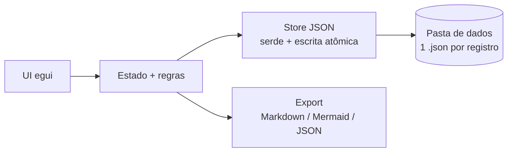

# MyProvenance — Versão 2 (stand-alone, Rust puro)

> Documento de planejamento. Status: **consulta/decisão** — nenhum código escrito. Data: 2026-11-04.

## Objetivo

Transformar o MyProvenance em app **desktop stand-alone**, **monousuário**, para **Windows** (foco atual; macOS/Linux fora do escopo por ora). Mapa: [Wayfinder #20](https://github.com/edalcin/MyProvenance/issues/20).

## Estado atual (v1, referência)

- SvelteKit 3 + `adapter-node` + `better-sqlite3`; ~13k linhas TS/Svelte.
- `schema.sql`: 8 tabelas — `registros`, `agentes`, `entidades`, `atividades`, `atividade_entidades_usadas`, `usuarios`, `sessoes`, `registro_compartilhamentos`.
- Módulos multiusuário: `auth`, `admin-auth`, `rate-limit`, compartilhamento.
- Export JSON por registro já existe: `gerarJsonExportado()` em `src/lib/export.ts` → `RegistroExportado`; import em `src/lib/server/db/repositories/import.ts`.
- UI dependente de web: TipTap (`rich-text-editor.svelte`), Mermaid (`mermaid-diagram.svelte`).

## Alternativas avaliadas

| Opção | Tamanho | Mudança | Veredito |
|---|---|---|---|
| Tauri 2 (shell Rust + UI Svelte) | ~5–15 MB | adapter-static, lógica para client/commands | Viável; WebView do sistema (Linux fraco) |
| **Rust puro** | ~5–15 MB | Reescrita total | **Escolhido** |
| Electron | ~150 MB+ | Mínima | Descartado (tamanho/RAM) |
| Node SEA / Bun compile | ~50–100 MB | Mínima; trocar `better-sqlite3` por `node:sqlite` | Descartado |
| PWA client (SQLite WASM) | 0 install | Sem servidor | Descartado (dados presos ao browser) |

## Decisões tomadas

1. **Rust puro**, sem WebView.
2. **Sem SQLite**: armazenamento em **JSON**, **um arquivo por registro**.
3. **TipTap → editor Markdown + preview** (perda aceita).
4. **Mermaid renderizado → grafo nativo** na tela; Mermaid continua só como **texto no export** (perda aceita).
5. Removidos: `usuarios`, `sessoes`, `registro_compartilhamentos`, auth, admin, rate-limit, compartilhamento.
6. Toolkit de UI: **egui** (`eframe`).

## Armazenamento JSON

- Formato base: `RegistroExportado` da v1 (permite importar dados da versão web).
- Campo `"versao": 1` em todo arquivo, para migrações futuras.
- **Escrita atômica obrigatória**: grava `.tmp` → `rename` (`tempfile::persist`).
- Validação na leitura (substitui FKs do SQLite): `serde` + `garde`.
- Local: pasta de dados do SO (`directories`) — `%APPDATA%`, `~/Library/Application Support`, `~/.local/share`.
- Listagem/busca: carregar todos os arquivos em memória na inicialização (ok até alguns milhares de registros).

| Aspecto | 1 arquivo por registro | JSON único |
|---|---|---|
| Corrupção | Afeta 1 registro | Afeta tudo |
| Escrita | Pequena | Regrava tudo |
| Sync (Git/Dropbox) | Bom, diff legível | Conflitos |
| Compartilhar | Envia o arquivo | Precisa exportar |

Futuro opcional: PROV-JSON (W3C) como formato nativo — mais interoperável, mais mapeamento.

## Stack Rust

| Função | Crate |
|---|---|
| App/UI | `eframe` + `egui` |
| Markdown | `egui_commonmark` (render), `pulldown-cmark` |
| Grafo | `egui_graphs` ou `egui::Painter` |
| Modelo/JSON | `serde`, `serde_json` |
| Validação | `garde` |
| IDs | `uuid` (feature `v7`) |
| Arquivos | `directories`, `tempfile`, `rfd` |
| Empacotamento | `cargo-packager` (.msi) |

Toolkits considerados: egui (escolhido — simples, ecossistema), Iced (API instável), Slint (licença GPLv3/royalty-free/comercial), Dioxus/Tauri (WebView, não é Rust puro).

### Mapeamento v1 → v2

| v1 | v2 |
|---|---|
| Svelte + bits-ui + Tailwind | egui |
| TipTap | textarea Markdown + preview |
| mermaid (render) | grafo nativo |
| `gerarRelatorioMarkdown`, `gerarDiagramaMermaid`, `gerarJsonExportado` | port direto |
| zod | serde + garde |
| marked + sanitize-html | pulldown-cmark (`ammonia` só se renderizar HTML) |
| `DB_PATH` | `directories` |

## Arquitetura



```
myprovenance/
  Cargo.toml
  src/
    main.rs        # eframe::run_native
    model.rs       # Registro, Agente, Entidade, Atividade
    store.rs       # listar/ler/gravar, escrita atômica, "versao"
    export.rs      # Markdown, Mermaid, JSON
    ui/
      lista.rs
      registro.rs  # formulário + editor Markdown
      grafo.rs
```

## Etapas

1. **Protótipo**: `model.rs`, `store.rs`, tela lista + tela registro. Valida UX egui e formato JSON.
2. **Port da lógica**: `cardinalidade.ts`, `relacao.ts`, `report.ts`, `mermaid.ts`, `export.ts`. Usar `*.test.ts` da v1 como especificação dos testes Rust.
3. **Grafo + export**.
4. **Acabamento**: tema claro/escuro, import do JSON da v1. Sem i18n (ADR-0007 mantida).
5. **Distribuição**: GitHub Actions `windows-latest`, `.msi` no Release. Assinatura Windows (SmartScreen) e builds macOS/Linux fora do escopo por ora.

## Decisões pendentes

Rastreadas no mapa [Wayfinder #20](https://github.com/edalcin/MyProvenance/issues/20) (Agentes, repositório, Rascunho/Finalizado, pasta de dados, formato JSON v2, viabilidade egui, protótipo).

Decidido: v1 web congelada após a v2 (só correções de segurança); v2 importa JSON da v1 em sentido único.
